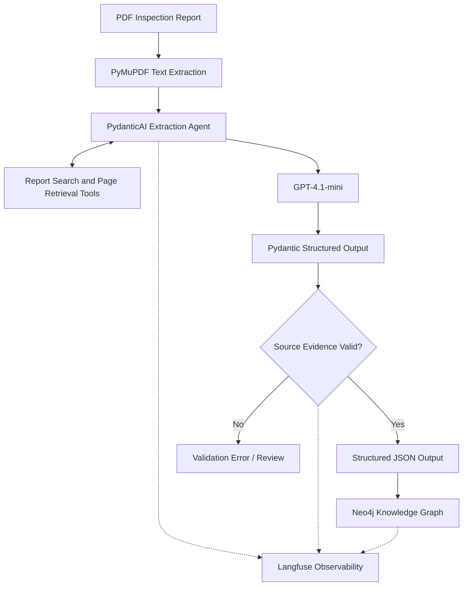
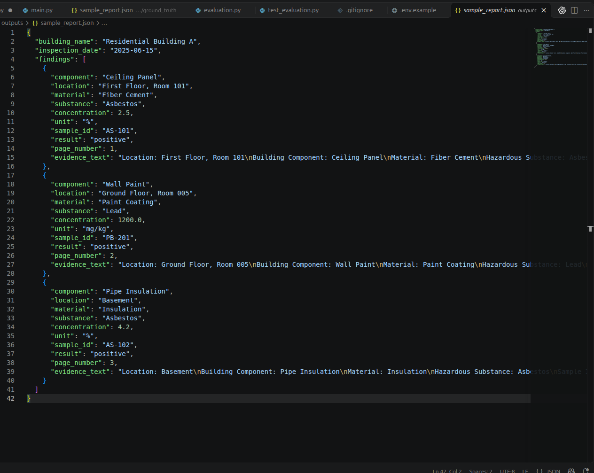
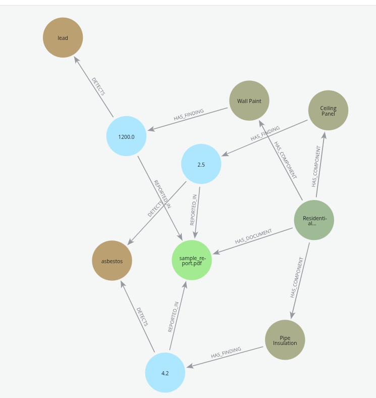
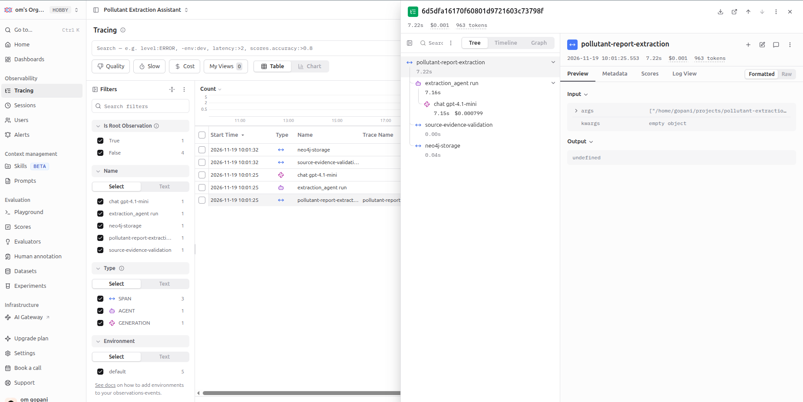
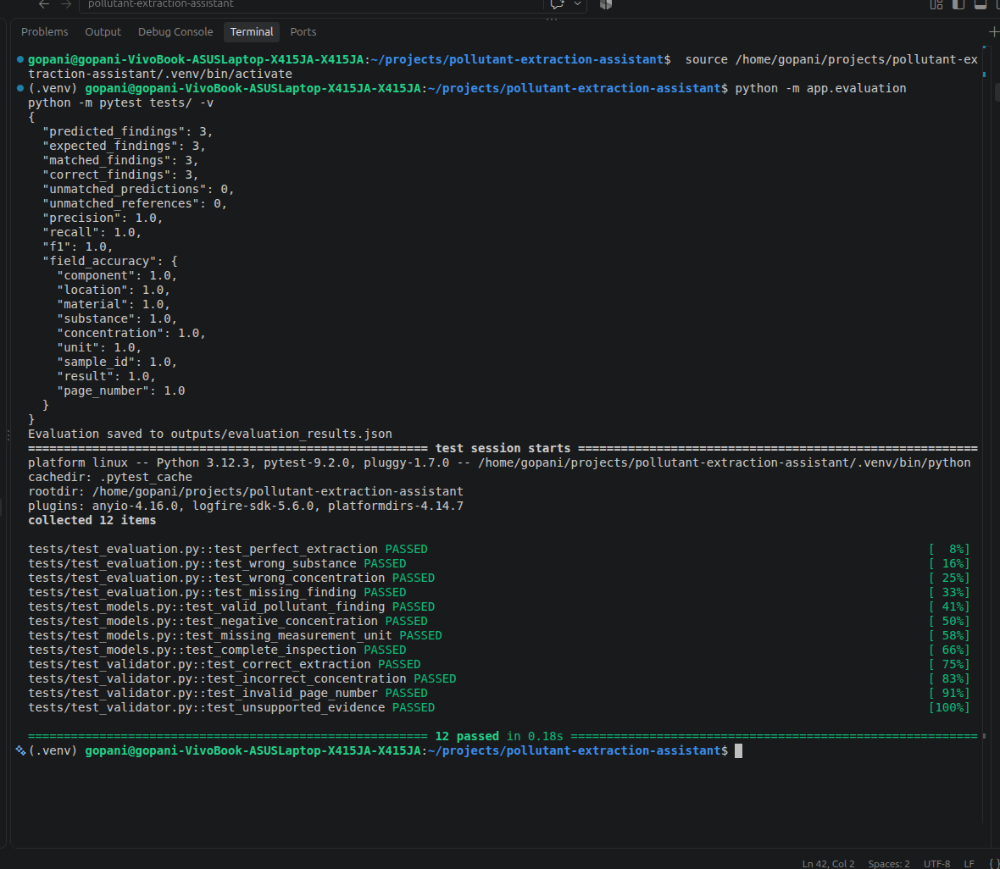

# Agentic Pollutant Report Extraction Assistant

**An LLM-assisted system for extracting hazardous substances, building components, and laboratory measurements from PDF inspection reports using PydanticAI, OpenAI, Neo4j, and Langfuse.**

**Tech Stack:** Python · PydanticAI · GPT-4.1-mini · Pydantic · PyMuPDF · Neo4j · Cypher · Langfuse · Pytest

## Overview

Building inspection reports often contain information about hazardous substances, material properties, laboratory measurements, and their associated building components. Manually extracting and organizing these findings can be time-consuming, particularly when maintaining traceability to original inspection records.

This project implements an LLM-assisted extraction pipeline that converts PDF inspection reports into validated, structured data and integrates the results into a Neo4j knowledge graph.

The application also incorporates agentic retrieval tools, source-evidence validation, execution tracing through Langfuse, and an evaluation framework for measuring extraction quality.

## Key Features

- **PDF Processing:** Extracts text from inspection reports while preserving original page numbers.
- **LLM-Based Information Extraction:** Identifies building components, locations, materials, hazardous substances, laboratory measurements, and sample identifiers.
- **Agentic Retrieval Tools:** Provides keyword-search and page-retrieval tools through PydanticAI.
- **Structured Output Validation:** Uses Pydantic schemas to enforce data types, required fields, and measurement constraints.
- **Source Evidence Validation:** Checks extracted values against supporting PDF passages and original page references.
- **Knowledge Graph Integration:** Stores relationships between buildings, components, substances, findings, and inspection documents in Neo4j.
- **Observability:** Uses Langfuse to trace model executions, validation operations, database storage, token usage, and latency.
- **Evaluation:** Measures finding-level precision, recall, F1 score, and field-level accuracy against reference annotations.

## System Architecture



The pipeline extracts information, validates it against source evidence, exports structured JSON, and stores linked entities in Neo4j. Langfuse provides execution-level observability across the workflow.

## Example Extraction Results

The initial demonstration uses a synthetic three-page building inspection report.

| Building Component | Hazardous Substance | Concentration | Sample ID | Source Page |
|---|---|---|---|---|
| Ceiling Panel | Asbestos | 2.5% | AS-101 | 1 |
| Wall Paint | Lead | 1200 mg/kg | PB-201 | 2 |
| Pipe Insulation | Asbestos | 4.2% | AS-102 | 3 |

Each extracted finding includes the component location, material, substance, concentration, unit, sample identifier, laboratory result, and supporting PDF evidence.

### Structured JSON Output



[View sample extraction JSON](examples/sample_extraction.json)

## Neo4j Knowledge Graph

Neo4j represents the relationships between extracted findings and their corresponding building inventory records.

### Graph Entities

| Entity | Description |
|---|---|
| Building | Inspected building |
| Component | Building element or material-containing component |
| Finding | Extracted pollutant measurement and evidence |
| Substance | Identified hazardous substance |
| InspectionDocument | Original inspection report |

### Relationships

- `Building → HAS_COMPONENT → Component`
- `Building → HAS_DOCUMENT → InspectionDocument`
- `Component → HAS_FINDING → Finding`
- `Finding → DETECTS → Substance`
- `Finding → REPORTED_IN → InspectionDocument`

### Knowledge Graph Visualization



The synthetic demonstration creates **10 nodes and 13 relationships** across the five entity types.

The graph supports queries to identify hazardous substances associated with specific building components and trace individual measurements back to their inspection documents.

## Langfuse Observability

Langfuse provides visibility into the extraction pipeline, including:

- PydanticAI agent execution
- GPT-4.1-mini model requests
- Token consumption and execution latency
- Source-evidence validation
- Neo4j persistence operations
- Execution errors

### Example Execution Trace



The demonstrated trace captures the extraction agent, model generation, source validation, and Neo4j storage operations.

Retrieval tools are registered with PydanticAI; individual runs may complete without calling them when sufficient information is already present in the supplied report text.

## Extraction Evaluation

A Python-based evaluation framework compares predicted extraction results against reference annotations.

### Metrics

- **Precision:** Proportion of extracted findings counted as correct.
- **Recall:** Proportion of reference findings correctly identified.
- **F1 Score:** Harmonic mean of precision and recall.
- **Field-Level Accuracy:** Accuracy of individual extraction fields, including component, substance, concentration, measurement unit, and source page.

### Initial Evaluation Results

| Metric | Result |
|---|---:|
| Reference Findings | 3 |
| Predicted Findings | 3 |
| Correct Findings | 3 |
| Precision | 1.00 |
| Recall | 1.00 |
| F1 Score | 1.00 |
| Field-Level Accuracy | 1.00 across evaluated fields |
| Automated Tests | 12 passed |

**Evaluation scope:** These results are from a single synthetic three-page demonstration report with three reference findings. They validate the initial pipeline and evaluation implementation; they are not representative of accuracy on unseen, real-world inspection reports.

### Evaluation and Test Execution



[View evaluation results](examples/evaluation_results.json)

## Project Structure

```text
pollutant-extraction-assistant/
├── app/
│   ├── __init